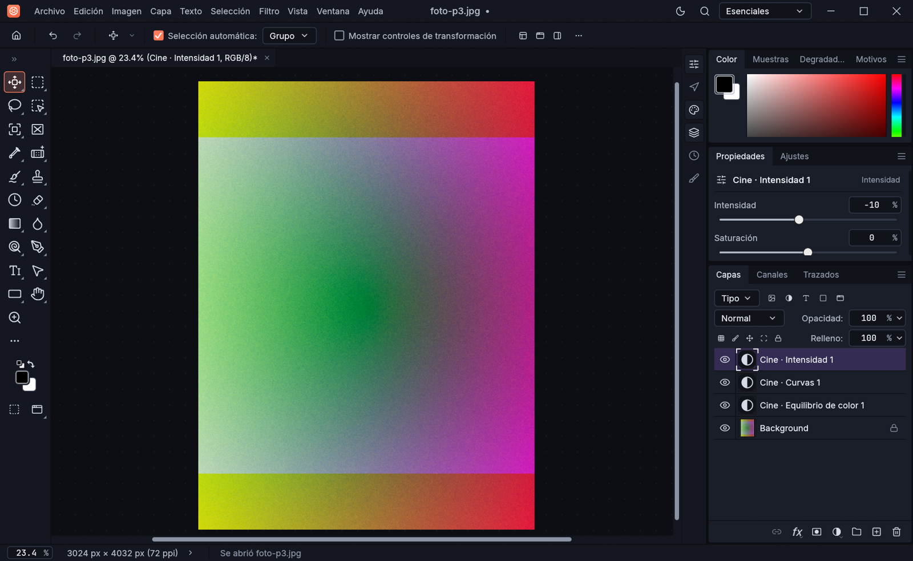

<div align="center">


# Lumen Photo Editor

**El editor de fotos para Windows rápido, nativo y sin suscripciones.**
Capas, máscaras, ajustes, filtros y PSD, en una app ligera hecha por [SifG22](https://sifg.net).

[](https://github.com/SifG22/lumen-photo-editor/releases/latest)
[](https://github.com/SifG22/lumen-photo-editor/releases)


### [⬇ Descargar para Windows](https://github.com/SifG22/lumen-photo-editor/releases/latest) · [sifg.net](https://sifg.net) · [Términos](assets/legal/TERMINOS.txt)



</div>

---

## ✨ Qué puedes hacer

| | |
|---|---|
| 🖼️ **Edición por capas** | Capas de píxeles, de texto, de forma y de ajuste, máscaras, modos de fusión, estilos de capa y objetos inteligentes. |
| 🎚️ **Ajustes no destructivos** | Curvas, niveles, tono/saturación, equilibrio de color, blanco y negro, filtro de fotografía… como capas que puedes retocar cuando quieras. |
| ⚡ **Estilos rápidos** | Un clic para darle a tu foto un look **Cálido, Frío, Vintage, B/N intenso, Cine o Pop**, hecho con capas de ajuste editables (Imagen › Estilos rápidos). |
| 📱 **Listo para redes** | Documentos y recortes exactos para **Instagram** (1:1 y 4:5), **Historias, Reels y TikTok** (9:16), **YouTube**, **X**, **Pinterest** y **Facebook**. |
| 💾 **Proyectos `.lumen`** | Guardan todo (capas, máscaras, efectos) para seguir editando más tarde o compartir el proyecto. |
| 📂 **Abre de todo** | PSD y PSB (con sus capas), JPEG, PNG, WebP, TIFF, HEIC, GIF, BMP, OpenEXR, SVG y RAW de cámara (CR2, CR3, NEF, ARW, DNG…). |
| 🖌️ **Herramientas de verdad** | Pinceles con presión, tampón de clonar, pincel corrector, selección rápida, varita mágica, lazo magnético, degradados, texto, pluma y formas. |
| 🌙 **Hecho para trabajar a gusto** | Tema oscuro propio, botones de deshacer y rehacer siempre a mano, atajos de teclado clásicos y la interfaz en español. |
| 🔄 **Se actualiza solo** | Te avisa cuando sale una versión nueva y se instala con un clic. |
| 🔒 **Tus fotos son tuyas** | Funciona sin conexión y no envía tus imágenes ni tus datos a ningún sitio. |

## ⬇️ Descargar e instalar

1. Entra en la **[última versión](https://github.com/SifG22/lumen-photo-editor/releases/latest)** y descarga el instalador de tu PC:

   | Tu PC | Archivo |
   |---|---|
   | La mayoría (Intel o AMD) | `Lumen-Setup-<versión>-x64.exe` |
   | Windows en ARM (Snapdragon, Surface Pro X / 11) | `Lumen-Setup-<versión>-arm64.exe` |

   ¿No sabes cuál? Configuración › Sistema › Información › *Tipo de sistema*. Si pone «procesador basado en ARM», el ARM64; si no, el x64.
2. Abre el archivo y pulsa **Instalar**. Lumen aparece en el menú Inicio y ya puedes borrar el archivo descargado.
3. Si Windows muestra **«Windows protegió su PC»**, pulsa *Más información* › *Ejecutar de todas formas*. Sale porque la app aún no está firmada digitalmente.

**Requisitos:** Windows 10 u 11 de 64 bits, 4 GB de RAM (8 GB recomendados) y una gráfica compatible con DirectX 12 (si no la hay, Lumen dibuja con el procesador).
**Versión portable:** también hay un `.zip` que no necesita instalación: descomprímelo y abre `Lumen.exe`.
**Desinstalar:** Configuración › Aplicaciones › Lumen Photo Editor.

## ❓ Preguntas frecuentes

<details>
<summary><b>¿Es gratis?</b></summary>

Sí. Puedes usarlo gratis, también para trabajos profesionales. Las imágenes que creas son tuyas.
</details>

<details>
<summary><b>¿Abre mis archivos de Photoshop?</b></summary>

Sí: abre y guarda PSD y PSB con sus capas, máscaras y capas de ajuste. Lumen no está afiliado a Adobe.
</details>

<details>
<summary><b>¿Necesita internet?</b></summary>

No. Solo consulta, como mucho una vez al día, si hay una versión nueva en la [página de versiones](https://github.com/SifG22/lumen-photo-editor/releases) de GitHub. Se puede desactivar con la variable de entorno `LUMEN_NO_UPDATE=1`.
</details>

<details>
<summary><b>¿Qué es un archivo .lumen?</b></summary>

El formato de proyecto de Lumen: guarda el documento entero con todas sus capas para seguir editándolo o compartirlo. Al instalar Lumen, los `.lumen` se abren con doble clic.
</details>

<details>
<summary><b>He encontrado un fallo o tengo una idea</b></summary>

Cuéntamelo en [sifg.net](https://sifg.net) o abre un *issue* en este repositorio.
</details>

## 🛠️ Compilar desde el código

Necesitas [Rust](https://rustup.rs) y las *Build Tools* de Visual Studio 2022 (carga de trabajo «Desarrollo para el escritorio con C++»).

```bat
generar-instalador.bat
```

Compila en modo release y deja en `dist\` el instalador, el ZIP portable y el `latest.json` del aviso de actualización (necesita [Inno Setup 6](https://jrsoftware.org/isinfo.php) para el instalador). Para solo compilar y abrir la app: `compilar-y-abrir.bat`.

Las versiones publicadas las compila **GitHub Actions** ([`lumen-release.yml`](.github/workflows/lumen-release.yml)) para x64 y ARM64 al subir una etiqueta `vX.Y.Z`.

## 📜 Términos, licencias y créditos

- El uso de Lumen Photo Editor se rige por los **[términos y condiciones de SifG22](assets/legal/TERMINOS.txt)**.
- El nombre **Lumen**, **Lumen Photo Editor**, su icono y su marca son de SifG22 y no se pueden usar sin permiso.
- Lumen Photo Editor está **basado en [PhotoCraft](https://github.com/storytold/photocraft)**, de los autores de PhotoCraft (ArtCraft team), y usa su código bajo la **licencia MIT** ([LICENSE-MIT](LICENSE-MIT), [NOTICE](NOTICE)). ¡Gracias a ese equipo por su trabajo!
- Las fuentes, iconos y demás componentes de terceros, con sus licencias, están en [ATTRIBUTION.md](ATTRIBUTION.md). El instalador los incluye en la carpeta `licencias`.
- Lumen no está afiliado ni respaldado por Adobe ni por el equipo de PhotoCraft/ArtCraft.

---

<div align="center">

Hecho con cariño por **[SifG22](https://sifg.net)**

</div>
